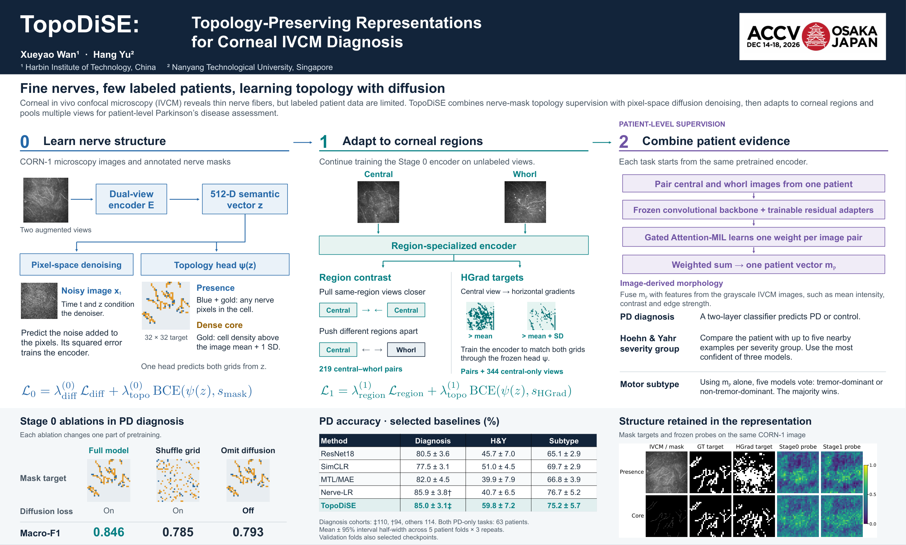

<h1 align="center">TopoDiSE</h1>

<p align="center"><strong>Topology-Preserving Representations for Corneal IVCM Diagnosis</strong><br>
Xueyao Wan and Hang Yu · ACCV 2026</p>

<p align="center">
  <a href="#accv-2026-poster">Poster</a> ·
  <a href="#quick-start">Quick start</a> ·
  <a href="#reproduce-the-paper">Reproduce the paper</a> ·
  <a href="README.zh-CN.md">中文说明</a>
</p>

TopoDiSE learns representations of corneal nerve structure from in vivo confocal microscopy (IVCM) images. The pipeline learns from nerve masks in Stage0, adapts to central and whorl views with dual-threshold horizontal gradients (HGrad) in Stage1, and combines evidence across images for patient-level prediction in Stage2.

## ACCV 2026 Poster

[](assets/topodise-accv-2026-poster.pdf)

[View the full-size poster (PDF)](assets/topodise-accv-2026-poster.pdf)

## Quick start

Use Python 3.10+ on Linux or macOS. Install PyTorch for your device, then install the remaining dependencies from the repository root.

```bash
python -m pip install -r requirements.txt
python -m experiments.topodise_experiments.batch_experiments --section main_tasks --dry-run
```

## Reproduce the paper

| Paper result | Entry point |
|---|---|
| PD diagnosis, H&Y grouping, TD/non-TD screening | [Main method and candidate recipes](experiments/topodise_experiments/README.md) |
| Supervision targets, frozen probes, component ablations, and inference replay | [Ablation guide and replay commands](ablation_experiments/README.md) |
| Image baselines | [Baseline experiment entry points](experiments) |
| Clinical nerve-metric baseline | [Nerve-LR protocol](experiments/nerve_metrics_lr_experiments/README.md) |

### Data and training

For training, supply authorized data. Image paths in the patient and regional manifests are relative to the dataset root.

```text
datasets/
  CORN-1/images/  and  CORN-1/labels/
  unlabeled_dataset_en/unlabeled_dataset_en.json
  pd_dataset_en/patients_dataset_en.json
  dm_dataset_en/dm_patients_dataset_en.json     # DM only
```

```bash
python -m experiments.topodise_experiments.batch_experiments --section main_tasks --dataset-root /path/to/datasets --phase prepare
python -m experiments.topodise_experiments.batch_experiments --section main_tasks --dataset-root /path/to/datasets --devices cuda:0
```

Stage1 also checks image filenames in the PD and DM directories for overlap with the regional pool.

The three PD tasks use pretraining seed 42 and five patient folds repeated three times. The paper reports means across the 15 validation folds. In the batch output, use `analysis/fold_metrics.csv` or the fold means in `analysis/summary.json`. The patient-cluster bootstrap report uses predictions pooled within each repeat. The paper's DM result is from the separate DMMIL3F1 experiment with a Frangi Stage1 checkpoint. The current four-task default also offers DM transfer from GT+HGrad.

### Baselines

Run the corresponding `experiments.<family>.batch_experiments` module. The image families are `basic_experiments` (ResNet18), `simclr_experiments`, `mtl_experiments`, `prototype_experiments`, `unet_experiments` and `gnn_experiments`. For U-Net-Only, U-Net-Dual and GNN, first generate the segmented images with `unet.prepare_dataset`, `unet.train --profile baseline` and `unet.build_pd_unet_dataset`, in that order. [Segmentation instructions](unet/README.md)

Nerve-LR uses 11 patient-averaged nerve measurements. Diagnosis includes 94 patients with eligible measurements and 110 paired-image patients for TopoDiSE. H&Y and subtype use the 63 PD patients. [Clinical baseline protocol](experiments/nerve_metrics_lr_experiments/README.md)

Clinical images, patient manifests, patient predictions and trained weights are excluded from this repository.
