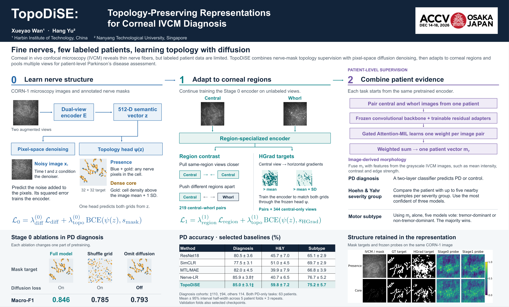

<h1 align="center">TopoDiSE</h1>

<p align="center"><strong>Topology-Preserving Representations for Corneal IVCM Diagnosis</strong><br>
Xueyao Wan、Hang Yu · ACCV 2026</p>

<p align="center">
  <a href="#accv-2026-海报">海报</a> ·
  <a href="#快速开始">快速开始</a> ·
  <a href="#复现实验">复现实验</a> ·
  <a href="README.md">English</a>
</p>

TopoDiSE 从角膜活体共聚焦显微镜（IVCM）图像中学习神经纤维的结构表征。Stage0 利用神经掩膜学习结构，Stage1 利用水平梯度双阈值目标（HGrad）适应中央区与涡旋区图像，Stage2 聚合同一患者的多张图像进行患者级预测。

## ACCV 2026 海报

[](assets/topodise-accv-2026-poster.pdf)

[查看原版海报（PDF）](assets/topodise-accv-2026-poster.pdf)

## 快速开始

在 Linux 或 macOS 上使用 Python 3.10+。先安装适合设备的 PyTorch，再从仓库根目录执行：

```bash
python -m pip install -r requirements.txt
python -m experiments.topodise_experiments.batch_experiments --section main_tasks --dry-run
```

## 复现实验

| 论文内容 | 复现入口 |
|---|---|
| PD 诊断、H&Y 分组、TD/non-TD 筛查 | [主流程与固定候选](experiments/topodise_experiments/README.zh-CN.md) |
| 监督目标对照、冻结探针、组件消融和推理重放 | [消融复现指南](ablation_experiments/README.zh-CN.md) |
| 图像基线 | [基线实验入口](experiments) |
| 临床神经指标基线 | [Nerve-LR 实验说明](experiments/nerve_metrics_lr_experiments/README.zh-CN.md) |

### 数据与训练

训练需要使用已获得授权的数据。清单中的图像路径相对于数据根目录。

```text
datasets/
  CORN-1/images/ 和 CORN-1/labels/
  unlabeled_dataset_en/unlabeled_dataset_en.json
  pd_dataset_en/patients_dataset_en.json
  dm_dataset_en/dm_patients_dataset_en.json     # 仅 DM 迁移实验需要
```

```bash
python -m experiments.topodise_experiments.batch_experiments --section main_tasks --dataset-root /path/to/datasets --phase prepare
python -m experiments.topodise_experiments.batch_experiments --section main_tasks --dataset-root /path/to/datasets --devices cuda:0
```

Stage1 还会检查 PD 和 DM 目录内的图像文件名，过滤区域池中的同名条目。

三个 PD 任务使用预训练种子 42，患者级五折重复三次。论文报告 15 折均值，对应 `analysis/fold_metrics.csv` 和 `analysis/summary.json` 的逐折汇总。患者 bootstrap 报告使用每次重复内合并的预测。论文 DM 表来自单独的 DMMIL3F1 实验，加载 Frangi Stage1 检查点。当前默认四任务流程也支持从 GT+HGrad 开始 DM 迁移。

### 基线

各方法入口为 `experiments.<family>.batch_experiments`。图像方法目录分别为 `basic_experiments`（ResNet18）、`simclr_experiments`、`mtl_experiments`、`prototype_experiments`、`unet_experiments`、`gnn_experiments`。U-Net-Only、U-Net-Dual、GNN 依次执行 `unet.prepare_dataset`、`unet.train --profile baseline` 和 `unet.build_pd_unet_dataset` 生成分割图。[分割说明](unet/README.md)

Nerve-LR 使用 11 项患者内平均的神经指标。诊断任务的指标队列有 94 人，TopoDiSE 配对图像队列有 110 人。H&Y 和亚型任务均为 63 名 PD 患者。[临床指标基线说明](experiments/nerve_metrics_lr_experiments/README.zh-CN.md)

仓库不分发临床图像、患者清单、个体预测或训练权重。
