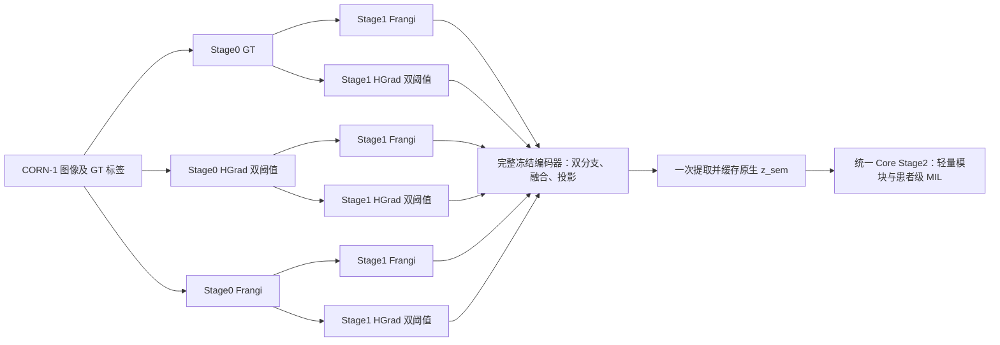

# 消融实验统一存放目录

本目录存放新消融协议、配置、权重、特征缓存、日志和汇总。当前实现 `topology_targets_v2` 的六组拓扑目标消融；后续实验也在本目录新增协议或实验名称。原有 TopoDiSE、Unified Stage2 和其他实验文件均不修改。

## 六种组合

| 实验名 | Stage0：CORN-1 | Stage1：同一无标签 manifest |
|---|---|---|
| `gt_frangi` | GT presence/core | 原有 Frangi 双阈值 |
| `hgrad_dual_frangi` | 新 HGrad 双阈值 | 原有 Frangi 双阈值 |
| `frangi_frangi` | 原有 Frangi 双阈值 | 原有 Frangi 双阈值 |
| `gt_hgrad_dual` | GT presence/core | HGrad 双阈值 |
| `hgrad_dual_hgrad_dual` | 新 HGrad 双阈值 | HGrad 双阈值 |
| `frangi_hgrad_dual` | 原有 Frangi 双阈值 | HGrad 双阈值 |

**Stage0 和 Stage1 的 HGrad 统一使用逐图双阈值，Stage1 的 Frangi 也使用逐图双阈值。** 所有 HGrad 组合均配置为 `hgrad_dual`；原有批内统一阈值、两通道相同的 `hgrad` 不参与本轮六组实验。六组是本轮指定的 3×2 设计，不包含旧 HGrad→旧 HGrad 的 c8 完整复现，也不包含去掉拓扑损失等其他消融。



每个预训练种子运行 **3 次 Stage0、6 次 Stage1、6 组 Stage2**。两条相同 Stage0 来源的路线共享本目录新训练的父检查点，不重复预训练，不读取旧 c8 结果。

## 目标和训练含义

所有目标均为 `[B,2,32,32]` 二值张量，以 BCE 监督拓扑头。这里的通道是 presence/core 或图像响应提示，不能直接写成真实 skeleton/branch 标签。

| 目标 | 响应图 | 通道 0 | 通道 1 |
|---|---|---|---|
| GT | 二值 mask 平均池化后的密度 D | `D > 0` | `D > 逐图均值 + 逐图标准差` |
| HGrad 双阈值 | 水平相邻像素绝对差，左侧补零后平均池化得到 H | `H > 逐图均值` | `H > 逐图均值 + 逐图标准差` |
| Frangi | 原实现多尺度 vesselness，平均池化后为 V | `V > 逐图均值` | `V > 逐图均值 + 逐图标准差` |
| 原有 HGrad（仅作历史对照，不参与本轮） | 同一水平梯度响应 H | `H > 整个 batch 的均值` | 与通道 0 相同 |

标准差沿每张图的所有空间位置计算，保持 Frangi 原实现的样本标准差定义。Stage0/1 共用的新版 HGrad 的 core 是 presence 的子集，但空白图等情况下两个通道仍可能相同。它不需要人工 mask；GT 需要。Frangi 参数保持 `sigmas=(1,2,3), beta=0.5, c=0.5`。

Stage0 仍使用现有图像及双视图增强、扩散损失与拓扑损失。GT 分支在本目录的 `AlignedCORN1Dataset` 中同步 **x_full 与 mask** 的裁剪、翻转、仿射，mask 用最近邻插值；保留图像三次独立增强的行为，并恢复 RNG，使 GT 不额外改变后续图像随机序列。原数据集文件不修改。

Stage1 对 HGrad 响应和 Frangi 响应均先池化，再分别以逐图均值和逐图均值加标准差生成两个通道；拓扑目标来自增强后的 central 图像，仍沿用原训练器的 `rscp_high` 冻结策略、区域对比损失与冻结拓扑头；`train_denoiser=False`。Stage0 的人工标签不会在 Stage1 再输入。所有六组使用同一无标签 manifest、相同损失权重和优化配置，因此此处改变的是目标来源。GT 使用额外人工标注信息，论文应明确其监督条件。

## 统一 Stage2 与训练耗时

直接调用 `experiments.unified_stage2_encoder_comparison.run_encoder`，固定使用它已有的 **`topodise_native_zsem`** 入口。该入口保留 Stage1 学到的双分支、双向 cross-attention 和投影，全部冻结；Stage1 最优检查点中的 `ema_encoder` 用于特征提取。没有复制或修改 Stage2 训练器。

选择此入口是为了评估完整的预训练表示。Unified 的另一个 `topodise_stage1` 入口仅取两分支 pooled CLS，会跳过预训练融合与投影；本轮六组全部使用原生 z_sem，因此不存在组间入口差异。

缓存特征后只训练 Core 的特征适配、Attention-MIL、形态学投影和分类模块。形态学特征在六组中统一保留。训练阶段不反传到编码器，也不逐 epoch 重算图像特征；沿用 Core 的患者批量训练。**没有为了加速缩减默认 epoch、折数或病例。实际 GPU 耗时仍需完整运行测量。**

默认设置：

- Stage0：200 epochs，batch 16，lr `1e-4`；Stage1：80 epochs，batch 16，lr `2e-5`。预训练种子 `[42]`，严格播种；可在入口增加种子。
- Stage2：`pd_binary`、`pd_stage`、`pd_subtype_tdrest` 三个任务；划分种子 `[42,202,3407]`；每个 5 外层折，内层验证比例 0.2。
- Stage2 保留 Core 默认最多 50 epochs 的内层选择，再用所选 epoch 数从头训练外层训练集，最后评估外层测试集。患者内 Cartesian 配对、每患者上限 8，配对种子 `20260831`。
- 每组 45 个外层折，六组合计 **270 个外层折**，每折含内层选择和外层重训。划分种子不等于预训练种子：默认只有一套独立 Stage0/1 训练。

## 运行

需要 Python ≥3.10 及项目现有 PyTorch、torchvision、NumPy、SciPy、scikit-learn、PyYAML 等依赖；具体依赖沿用 `codes/requirements.txt`。下列命令在 **codes 目录**运行。也可从任意目录直接运行本目录 `batch_experiments.py` 的绝对路径。

主要参数集中在 `batch_experiments.py` 顶部。默认数据来自 `codes/datasets`，默认输出在本目录 `results/topology_targets_v2`。此前 Stage1 使用旧 HGrad 的 v1 仅生成过本地配置，未启动完整训练；v2 使用独立协议锁，不复用这些旧配置。

```bash
# 查看六组任务及共享父节点；不写文件、不导入 torch。
python -m experiments.ablation_experiments.batch_experiments --dry-run

# 审计数据并保存全部配置；不启动训练。
python -m experiments.ablation_experiments.batch_experiments --phase prepare

# 在训练服务器完整运行；设备编号遵循 CUDA_VISIBLE_DEVICES。
python -m experiments.ablation_experiments.batch_experiments --devices cuda:0 cuda:1

# 分阶段运行，先完成 pretrain，再运行统一 Stage2。
python -m experiments.ablation_experiments.batch_experiments --phase pretrain --devices cuda:0
python -m experiments.ablation_experiments.batch_experiments --phase stage2 --devices cuda:0

# 单组测试；all 会自动包含该组所需的 Stage0、Stage1。
python -m experiments.ablation_experiments.batch_experiments --variants gt_frangi --devices cuda:0

# 已有新 Stage1 后，每组先跑一个待完成的 Stage2 折；标记为不完整结果。
python -m experiments.ablation_experiments.batch_experiments --phase stage2 --max-folds 1 --devices cuda:0

# 汇总当前结果，即使尚未全部完成。
python -m experiments.ablation_experiments.batch_experiments --phase analyze
```

其他数据位置用 `--dataset-root /path/to/datasets`，必要时指定 `--corn1-root`、`--pd-json`、`--stage1-manifest`。输出限制在本目录下，另开协议用 `--name topology_targets_v3`。`--pretrain-seeds 42 202 3407` 会真正训练三套 Stage0/1，但必须使用新实验名，不能混入默认单种子结果。

不带参数会启动完整训练；初次核对用 `--dry-run` 或 `--phase prepare`。

## 目录、续跑与比较

```text
ablation_experiments/
  batch_experiments.py          配置与 GPU 调度
  topo_targets.py               新 HGrad 双阈值
  aligned_corn.py               GT 几何同步
  audit.py / worker.py          数据审计、预训练包装与 Core 调用
  analyze.py / tests/           汇总与 CPU 验证
  results/topology_targets_v2/
    protocol.json              全部任务与实现源码哈希锁
    input_audit.json            实际样本统计、图像/mask 内容哈希
    common_stage2_manifests/    预先校验的共同配对和患者划分
    configs/                   15 个任务配置（3+6+6）
    logs/                      每项任务独立日志
    pretrain_seed42/
      stage0/{gt,hgrad_dual,frangi}/ckpt/
      stage1/{六个实验名}/ckpt/
      stage2/{六个实验名}/
        core_config.json       展开后的 Unified Core 完整配置
        protocol/              队列、配对、患者划分记录
        feature_cache/         Core 特征缓存
        runs/                  各任务、种子、折的预测、指标、权重
        interrupted/           显式重试时保留的中断折
    analysis/                  fold_metrics.csv、summary.json
```

Stage0/1 从各自 `last.pt` 续训，完成后以独立标记和检查点哈希跳过。Stage1 必须读取本协议已完成的 Stage0；Stage2 必须读取本协议已完成的 Stage1。每项任务有进程锁，防止两个入口同时写相同检查点。

Stage2 默认跳过已完成折，遇到非空但未完成的折目录会报错。检查后加 `--retry-incomplete`：将中断折移入本实验的 `interrupted/`，再调用原 Core 入口，仅重跑尚未完成的折。不会删除已有结果，也不会用 `--force` 重训所有完成折。

协议锁阻止在同名结果中更换目标、参数、种子、数据或训练实现；更换训练实现后使用新 `--name`。迁移服务器应复制源代码与数据，在服务器重新 `prepare`；本机生成的配置是绝对路径，不应直接搬作服务器配置。同一轮 GPU 槽位可变化，但执行设备类型变更可能触发 Core 配置锁。

汇总只收录有 `DONE.json` 的折，记录缺失数量，并校验不同组的队列/配对/划分哈希。均值和标准差按折计算，重叠的 CV 折不能当作独立重复。汇总同时列内层验证和外层测试指标，**不自动根据外层测试成绩宣布“最佳方法”**。若要从六组中选择最终方法，需预先固定选择标准，并为选择后的方法保留独立评估，或在嵌套验证中纳入方法选择。

## 本地验证记录（2026-09-14）

本机 `codes/datasets` 核验结果：CORN-1 1,516 张及 1,516 个 mask；Stage1 有效 563 条，其中真实配对 219、单区域复制 344，排除与 PD/DM 重名的 19 条。这个过滤是现有文件名规则，不等于完成了跨数据集患者身份核验；论文中不能将原 manifest 的 582 条直接写成实际训练条数。

测试命令：

```bash
python -m pytest -q experiments/ablation_experiments/tests -p no:cacheprovider
```

测试覆盖新版 HGrad 的逐图阈值/批次独立性、Stage1 两种目标的双阈值与批次独立性、历史目标数值保持、GT 对齐和 RNG 保持、共享父节点、协议锁、续跑归档；并以合成小图实际运行三种 Stage0 和六种 Stage1 各 1 epoch，再对六个完整冻结表示运行 Core 的内层选择→外层重训→测试。测试临时权重不计入正式消融结果。本地 CPU 测试不代表完整 GPU 训练或性能结论。
