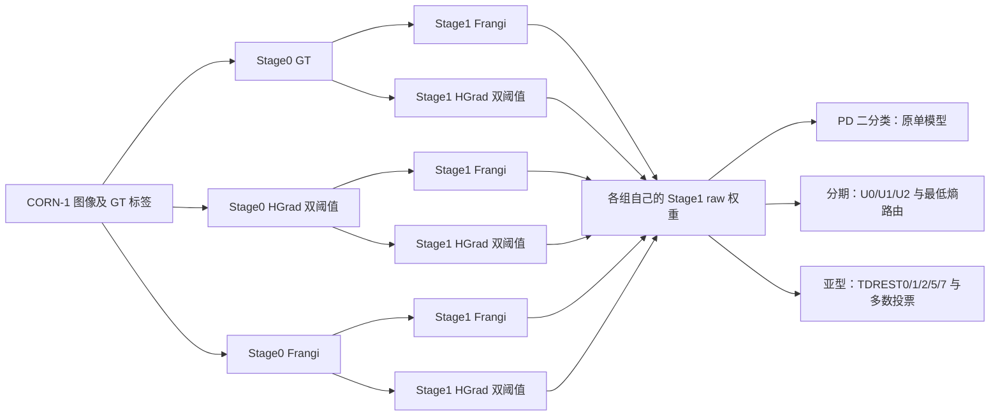

# 消融实验统一存放目录

本目录存放新消融协议、配置、权重、特征缓存、日志和汇总。当前默认实现 `topology_targets_v3_full`：六组拓扑目标消融接入原 TopoDiSE 完整 Stage2；后续实验也在本目录新增协议或实验名称。原有 TopoDiSE、Unified Stage2 和其他实验文件均不修改。

## 六种组合

| 实验名 | Stage0：CORN-1 | Stage1：同一无标签 manifest |
|---|---|---|
| `gt_frangi` | GT presence/core | 原有 Frangi 双阈值 |
| `hgrad_dual_frangi` | 新 HGrad 双阈值 | 原有 Frangi 双阈值 |
| `frangi_frangi` | 原有 Frangi 双阈值 | 原有 Frangi 双阈值 |
| `gt_hgrad_dual` | GT presence/core | HGrad 双阈值 |
| `hgrad_dual_hgrad_dual` | 新 HGrad 双阈值 | HGrad 双阈值 |
| `frangi_hgrad_dual` | 原有 Frangi 双阈值 | HGrad 双阈值 |

**Stage0 和 Stage1 的 HGrad 统一使用逐图双阈值，Stage1 的 Frangi 也使用逐图双阈值。** 所有 HGrad 组合均配置为 `hgrad_dual`；原有批内统一阈值、两通道相同的 `hgrad` 不参与本轮六组实验。六组是本轮指定的 3×2 设计，不包含旧 HGrad→旧 HGrad 的 c8 完整复现，也不包含去掉拓扑损失等其他消融。



每个预训练种子运行 **3 次 Stage0、6 次 Stage1、6 组 Stage2**。两条相同 Stage0 来源的路线共享本目录新训练的父检查点，不重复预训练，不读取旧 c8 结果。

## 目标和训练含义

所有目标均为 `[B,2,32,32]` 二值张量，以 BCE 监督拓扑头。这里的通道是 presence/core 或图像响应提示，不能直接写成真实 skeleton/branch 标签。

| 目标 | 响应图 | 通道 0 | 通道 1 |
|---|---|---|---|
| GT | 二值 mask 平均池化后的密度 D | `D > 0` | `D > 逐图均值 + 逐图标准差` |
| HGrad 双阈值 | 水平相邻像素绝对差，左侧补零后平均池化得到 H | `H > 逐图均值` | `H > 逐图均值 + 逐图标准差` |
| Frangi | 原实现多尺度 vesselness，平均池化后为 V | `V > 逐图均值` | `V > 逐图均值 + 逐图标准差` |
| 原有 HGrad（仅作历史对照，不参与本轮） | 同一水平梯度响应 H | `H > 整个 batch 的均值` | 与通道 0 相同 |

标准差沿每张图的所有空间位置计算，保持 Frangi 原实现的样本标准差定义。Stage0/1 共用的新版 HGrad 的 core 是 presence 的子集，但空白图等情况下两个通道仍可能相同。它不需要人工 mask；GT 需要。Frangi 参数保持 `sigmas=(1,2,3), beta=0.5, c=0.5`。

Stage0 仍使用现有图像及双视图增强、扩散损失与拓扑损失。GT 分支在本目录的 `AlignedCORN1Dataset` 中同步 **x_full 与 mask** 的裁剪、翻转、仿射，mask 用最近邻插值；保留图像三次独立增强的行为，并恢复 RNG，使 GT 不额外改变后续图像随机序列。原数据集文件不修改。

Stage1 对 HGrad 响应和 Frangi 响应均先池化，再分别以逐图均值和逐图均值加标准差生成两个通道；拓扑目标来自增强后的 central 图像，仍沿用原训练器的 `rscp_high` 冻结策略、区域对比损失与冻结拓扑头；`train_denoiser=False`。Stage0 的人工标签不会在 Stage1 再输入。所有六组使用同一无标签 manifest、相同损失权重和优化配置，因此此处改变的是目标来源。GT 使用额外人工标注信息，论文应明确其监督条件。

## 默认运行原 TopoDiSE 完整 Stage2

默认 `STAGE2_BACKEND = "full"`，直接调用原来的
`experiments.topodise_experiments.stage2_racf_downstream.main.run_single_experiment`。
三个任务的配置从 `topodise_experiments/batch_experiments.py` 的
`MAIN_TASKS_EXPERIMENTS` 读取，不重新设计分类头，也不使用冻结特征缓存替代原训练。

| 任务 | 原有完整配置 | 最终输出规则 |
|---|---|---|
| `pd_binary` | PAPER_BINARY_US0 单模型 | 该模型的患者预测 |
| `pd_stage` | U0、U1、U2，保留各自原型、融合微调、特征扩散等设置 | 每次患者预测选择概率熵最低的候选 |
| `pd_subtype_tdrest` | TDREST0、1、2、5、7，保留各自 focal、类别权重、特征扩散等设置 | 5 个候选多数投票，平票按平均概率处理 |

亚型为 **TD vs 非 TD 二分类**，不是 TD/PIGD/mixed 三分类。六组使用相同的上述三套任务配置，变化的仅是各自 Stage0/1 的拓扑监督和对应父权重。

- Stage2 读取各组 Stage1 检查点的 **原始 `encoder` 权重**，与原 TopoDiSE 的加载实现相同；Unified 的 EMA 配置不参与完整路径。
- 依照各候选配置训练原有适配器、融合层、MIL、形态学投影、原型和特征扩散等启用模块。并非整个编码器始终冻结；本目录不额外改变原冻结策略。
- 保留训练图像增强、配对规则、优化器、早停及最佳 epoch 选择逻辑。完整路径不能用一次缓存的 `z_sem` 替代这些计算。
- 默认每候选最多 50 epochs、患者五折、重复 3 次；划分种子按原代码为 **42、1042、2042**。为六组统一设置确定性训练；`num_workers=0` 默认沿用进程内图像解码缓存。
- 每组训练 **9 个候选 × 15 折 = 135 个候选折**；六组合计 **810 个候选折**。最终汇总为六组 × 三任务 × 15 折 = 270 个任务结果。完整路径的耗时会明显高于 Unified。

最终报告固定使用表中的单模型、最低熵路由和多数投票，不根据本轮成绩选择集成规则，不使用原控制器的标签 oracle 上界。Accuracy 和 Macro-F1 均从实际患者预测类别计算；多数投票预测可能不同于平均概率的 argmax，计算指标时不会混淆。

**评估口径跟随原 Stage2：每个验证折也参与最佳 epoch 选择。** 因此输出是原方法的验证选择交叉验证结果，不应标为 Unified 的嵌套外层独立测试成绩。恢复完整方法并不保证复现历史分数，六组父权重本身已变化。

## 运行方式

需要 Python ≥3.10 及 `codes/requirements.txt` 中的现有依赖。以下命令在 **codes 目录**运行；参数集中在本目录 `batch_experiments.py` 顶部。

```bash
# 核对默认六组完整流程，不写文件、不启动训练。
python -m experiments.ablation_experiments.batch_experiments --dry-run

# 保存配置并核验图像、mask 和完整 Stage2 的真实患者划分。
python -m experiments.ablation_experiments.batch_experiments --phase prepare

# 从 Stage0 开始，运行六组预训练及完整 Stage2。
python -m experiments.ablation_experiments.batch_experiments --devices cuda:0 cuda:1

# 同一 v3_full 批次预训练已完成时，只跑完整 Stage2。
python -m experiments.ablation_experiments.batch_experiments --phase stage2 --devices cuda:0

# v2 的六组预训练已完成时，直接复用它们跑完整 Stage2。
python -m experiments.ablation_experiments.batch_experiments \
  --phase stage2 \
  --pretrained-from experiments/ablation_experiments/results/topology_targets_v2 \
  --devices cuda:0 cuda:1

# 只运行一组，三个任务仍完整执行。
python -m experiments.ablation_experiments.batch_experiments \
  --variants gt_frangi --devices cuda:0

# 先跑五折、一次重复；必须使用独立实验名，避免混入正式 5×3 结果。
python -m experiments.ablation_experiments.batch_experiments \
  --name topology_targets_full_5fold --full-stage2-repeats 1 --devices cuda:0

# 汇总已经完成的任务及缺失项。
python -m experiments.ablation_experiments.batch_experiments --phase analyze
```

默认输出 `results/topology_targets_v3_full`。v1/v2 配置和结果不覆盖。
`--pretrained-from` 要传已有结果目录路径；会核对所选组的 Stage0/1 配置、完成标记、检查点哈希、父子对应关系和数据内容。只改 Stage2 时可复用权重，不复制大文件，也不重新训练。该参数只允许配合 `all/stage2/prepare/analyze`，其中 `all` 实际只调度 Stage2。未完成或目标来源不同的预训练不能复用。

异地数据用 `--dataset-root /path/to/datasets`，必要时同时指定 `--corn1-root`、`--pd-json`、`--stage1-manifest`。配置含本机绝对路径，迁移服务器应在服务器重新生成配置。新增预训练种子用 `--pretrain-seeds`，并使用新 `--name`；预训练种子和 Stage2 划分重复是两个独立设置。

## 保留 Unified 快速对照入口

原简化路径保留为可选 `--stage2-backend unified`，默认写入独立的 `results/topology_targets_v3_unified`，不和完整结果混合：

```bash
python -m experiments.ablation_experiments.batch_experiments \
  --stage2-backend unified --phase stage2 \
  --pretrained-from experiments/ablation_experiments/results/topology_targets_v2 \
  --devices cuda:0
```

该路径仍使用 `topodise_native_zsem`、Stage1 EMA 权重、完整冻结编码器、缓存特征和 Core 患者级 MIL，保留内层选 epoch 与外层测试。默认划分种子为 `[42,202,3407]`，与完整路径不同。`--max-folds` 只用于 Unified 调试，不适用于完整路径。

## 输出与续跑

```text
ablation_experiments/
  batch_experiments.py       预训练、完整/Unified Stage2 选择及设备调度
  full_stage2.py             读取原任务配方、执行候选、固定规则汇总
  reuse_pretrain.py          验证并复用已完成的旧批次父权重
  topo_targets.py            Stage0/1 共用 HGrad 双阈值
  aligned_corn.py            GT 图像-mask 几何同步
  audit.py / worker.py       输入审计、任务执行
  analyze.py / tests/        汇总与测试
  results/topology_targets_v3_full/
    protocol.json           所有任务、候选配置和源码哈希
    input_audit.json         数据内容哈希与有效样本统计
    full_stage2_manifests/   原 Stage2 实际配对及划分
    configs/                3 个 Stage0、6 个 Stage1、6 个 Stage2 配置
    logs/                   各组日志
    pretrain_seed42/
      stage0/{目标}/ckpt/
      stage1/{六组名称}/ckpt/
      stage2/{六组名称}/
        pd_binary/{候选名}/
        pd_stage/{U0、U1、U2}/
        pd_subtype_tdrest/{五个候选}/
          ablation_config.json
          full_stage2_{任务}/   原训练器日志、每折检查点、partial_results
          result.json           原候选全部结果
          DONE.json             候选完成标记
        {任务}/task_summary.json
        full_stage2_summary.json
        DONE.json
    analysis/summary.json
    analysis/fold_metrics.csv
```

Stage0/1 从 `last.pt` 续训，完成后按标记与哈希跳过。完整 Stage2 自动复用原训练器已完成折；中断折从该折起点重跑，不声称支持 epoch 级优化器续训。已完成候选按标记跳过，三个任务彼此独立保存。

汇总要求一个任务的所有指定候选、全部折和患者预测都齐全；不齐全时不会把缺失候选排除后悄悄报告一个不同的集成。不同消融组的患者划分和标签也会对齐检查。汇总输出每折 Accuracy、Balanced Accuracy、Macro-F1 及其均值、样本标准差，不自动宣布最佳方法。重复 CV 的重叠折不能作为独立患者样本。

Unified 的中断折处理仍沿用旧行为：检查后使用 `--retry-incomplete` 归档中断折，再运行尚未完成折。完整路径无需此标志，自动使用原训练器的折级恢复。

## 验证

```bash
python -m pytest -q experiments/ablation_experiments/tests -p no:cacheprovider
```

包括：双阈值正确性与批次独立性、GT 增强同步、完整配方逐项一致、六组 54 个候选的路由与跳过、部分结果拒绝汇总、熵路由与多数投票及 F1 计算、旧预训练复用验证。合成小图测试实际运行完整 Stage2 三任务全部 9 个候选，每个两折、4 epochs，覆盖原型和特征扩散启用后的执行路径；临时数据和权重不计入正式实验。

本机数据审计：CORN-1 1,516 张及对应 mask；Stage1 有效样本 563 条（真实配对 219，单区域复制 344），按现有文件名规则排除 PD/DM 重名记录 19 条。此规则不等于患者身份核验。尚未启动真实数据的六组完整 GPU 训练。
